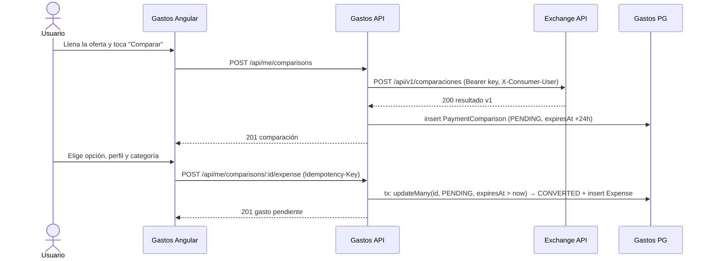
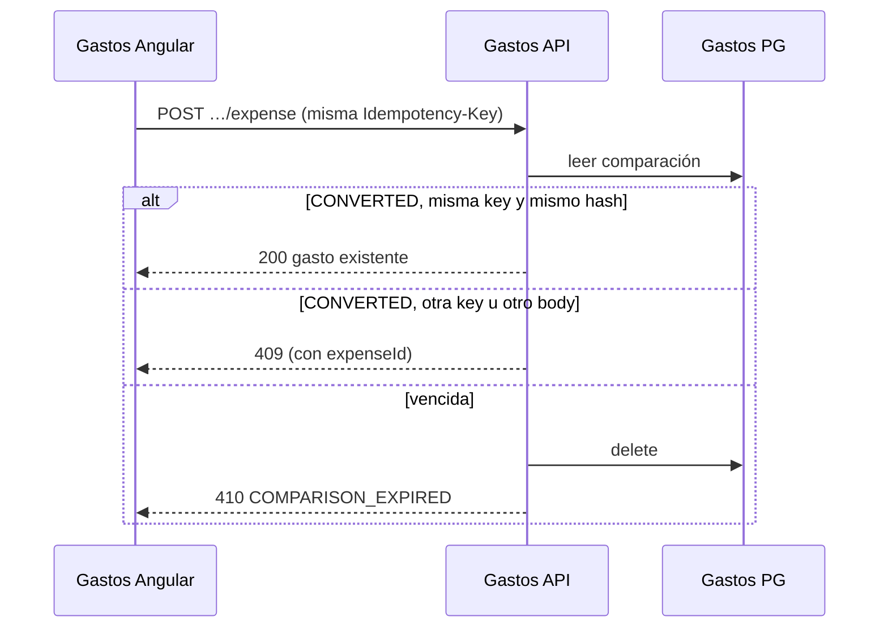
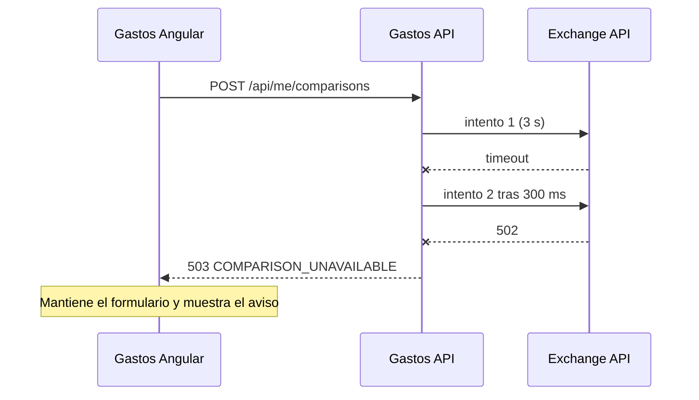
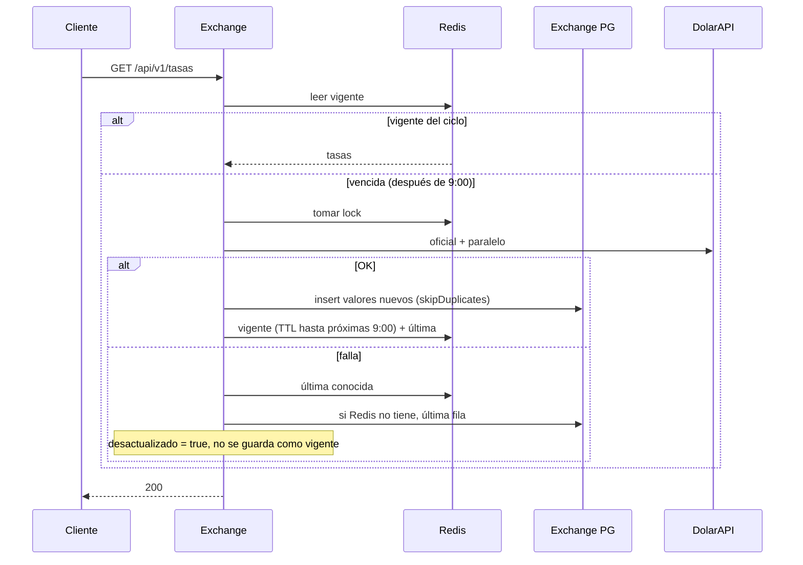

# Design: payment-comparison

Status: `IN_REVIEW` · Base: proposal v3 (ADR-003) + specs `rates`, `payment-comparison` (Exchange),
`gastos-comparisons`, `expenses` (backend), `gastos-app` (frontend).

## 1. Technical decisions

| ID | Decision | Why | Alternatives discarded |
|---|---|---|---|
| TD-1 | **decimal.js** for the engine in Exchange; money travels as **decimal strings** in JSON; Gastos stores `Prisma.Decimal` | `Prisma.Decimal` is decimal.js, so both sides round the same way; JSON numbers lose precision with Bs amounts | big.js (smaller, but a second rounding implementation); integers in cents (Bs rates need 6 decimals) |
| TD-2 | **Prisma 7** in Exchange for its PostgreSQL | Same tooling and migration flow the team already uses in Gastos | Drizzle / postgres.js (one more tool to learn for one table) |
| TD-3 | New Nest module **`src/payment-comparison/`** in Gastos, not more code in `MeService` | `me.service.ts` is already ~1.860 lines; the feature has its own client, storage and cron | Adding methods to `MeService` |
| TD-4 | `MeService` exposes **one** new public method `resolveExpenseContext()` (category, profile, reference month) reused by the comparison module | Keeps category/profile/budget-cycle rules in one place (DRY) | Copying the private resolvers |
| TD-5 | Idempotency stored **on the comparison row** (`convertIdempotencyKey`, `convertRequestHash`) plus a conditional `updateMany … where status = PENDING` | A comparison converts exactly once, so no generic idempotency table is needed; the conditional update closes the race between two taps | Generic `IdempotencyKey` table (more code, same guarantee for this case) |
| TD-6 | Cleanup with **`@nestjs/schedule`** hourly + Redis lock `gastos:lock:comparison-cleanup`, and deletion on access | Coolify may run more than one replica; the lock makes it run once | `setInterval` (no lock, harder to test) |
| TD-7 | Exchange consumer keys stored **hashed** in env (`EXCHANGE_CONSUMER_KEYS`), compared with `timingSafeEqual` | No DB table for one consumer; rotation = two entries for the same consumer | Plain keys in env; a consumers table |
| TD-8 | Rate limiting in Exchange with Redis fixed window (`INCR` + `EXPIRE`), in-memory fallback like today's `almacen-tasas` | Reuses the existing Redis abstraction | `@upstash/ratelimit` (vendor-specific) |
| TD-9 | The public web keeps computing **in the browser** with the same engine module | Instant results; PC-004 holds because it is literally the same code | Forcing the web through `POST /api/v1/comparaciones` |

## 2. Exchange Rate (repo `exchange-rate`)

### 2.1 Data model (new PostgreSQL)

```prisma
enum TipoTasa {
  OFICIAL
  PARALELO
}

/// Una fila por valor nuevo publicado por la fuente; Redis sirve las lecturas.
model TasaHistorial {
  id          String   @id @default(uuid())
  tipo        TipoTasa
  valor       Decimal  @db.Decimal(18, 6)
  fechaFuente DateTime                      // fechaActualizacion de DolarAPI
  cicloYmd    DateTime @db.Date             // día Caracas del ciclo de las 9:00
  fuente      String   @default("dolarapi")
  obtenidaEn  DateTime @default(now())

  @@unique([tipo, fechaFuente, valor])      // dos réplicas refrescando a la vez no duplican
  @@index([tipo, obtenidaEn(sort: Desc)])
}
```

Insert with `createMany({ skipDuplicates: true })`, and only when the value differs from the latest row of that type
(RATES-001).

### 2.2 Rates flow (changes to `lib/server/servicio-tasas.ts`)

Today the service already avoids cache poisoning: `vigente` is written only after a successful DolarAPI call and the
fallback is served with `desactualizado: true`. The change adds PostgreSQL as the durable layer:

| Step | Today | After |
|---|---|---|
| DolarAPI OK | write `vigente` + `ultima` in Redis | **insert new values in `TasaHistorial`**, then write Redis |
| DolarAPI fails | `ultima` from Redis (7-day TTL) or throw | `ultima` from Redis, else **latest rows from PostgreSQL**, else 503 |
| Redis cold start | refresh from DolarAPI | if the latest PG rows belong to the current cycle, serve them and repopulate Redis without calling DolarAPI |

A new dependency `historial: RepositorioTasas` is injected next to `almacen`, so the existing unit tests keep the
same shape (in-memory fake).

### 2.3 Engine

```
lib/motor/
  comparar.ts         // compararOferta(oferta, tasas): ResultadoComparacion  (decimal.js)
  comparar.test.ts    // golden vectors PC-001
  contrato-v1.ts      // types + parse/serialize of the API contract (strings)
lib/calcular.ts       // adapter for the UI: calls motor, returns numbers as today
```

The current `lib/calcular.ts` logic (number-based) moves into `lib/motor/comparar.ts` on `Decimal`; the UI keeps its
types through the adapter, so no screen changes.

### 2.4 API contract v1

`GET /api/v1/tasas`

```json
{
  "oficial":  { "valor": "883.400000", "fechaFuente": "2026-10-21T13:00:00Z" },
  "paralelo": { "valor": "1100.000000", "fechaFuente": "2026-10-21T13:05:00Z" },
  "cicloYmd": "2026-10-21",
  "desactualizado": false,
  "proximaActualizacion": "2026-10-22T13:00:00Z"
}
```

`POST /api/v1/comparaciones`

```json
// request
{
  "metodos": ["efectivo", "electronico", "bs"],
  "precioUsd": "380.00",
  "precioBs": { "modo": "monto_bs", "monto": "391400.00" },
  "comisionElectronicoPct": "3",
  "tasaVenta": "1100"
}
```

`precioBs.modo` is `monto_bs` | `usd_bcv` (`montoUsd`) | `usd_otra_tasa` (`montoUsd`, `tasaVendedor`), the same modes
the web already supports. `tasaVenta` is optional (falls back to `paralelo`).

```json
// response 200
{
  "version": "v1",
  "computedAt": "2026-10-21T18:30:00Z",
  "tasas": { "oficial": { "valor": "883.400000", "fechaFuente": "…" }, "paralelo": { … }, "desactualizado": false },
  "tasaVenta": { "valor": "1100.000000", "origen": "usuario" },
  "opciones": [
    {
      "id": "bs", "moneda": "BS", "montoCobrado": "391400.00",
      "equivalenteBcvUsd": "443.06", "comisionPct": null, "comisionUsd": null,
      "costoRealUsd": "355.82", "costoRealBs": "391400.00", "diferenciaVsMejorUsd": "0.00",
      "esMejor": true, "empatada": false
    }
  ],
  "mejorOpcion": "bs",
  "empateTotal": false,
  "tasaEquilibrio": "1030.00",
  "recargoBsPct": "16.60"
}
```

Errors: `400 { "errores": { "campo": "mensaje" } }`, `401` invalid key, `429` rate limit, `503` no rates at all.

### 2.5 Consumers and limits

- `EXCHANGE_CONSUMER_KEYS="gastos:<sha256 key A>,gastos:<sha256 key B>"`.
- `Authorization: Bearer <key>` → hash → match → consumer `gastos`; requires `X-Consumer-User`.
- Limits: consumer 60/min per `X-Consumer-User`; anonymous 30/min per IP (`x-forwarded-for` first hop, trusted
  only behind Coolify's proxy); `GET /api/v1/tasas` 60/min per IP.
- Logs: consumer name + user id + latency, never the key.
- `/api/tasas` stays as the web's internal route (its own shape); `/api/v1/tasas` is the public contract for consumers. Both read the same service.

### 2.6 Exchange environment

| Variable | Use |
|---|---|
| `DATABASE_URL` | New PostgreSQL (separate database from Gastos) |
| `REDIS_URL` | Existing |
| `EXCHANGE_CONSUMER_KEYS` | Hashed consumer keys |

## 3. Gastos backend (this repo)

### 3.1 Module layout

```
src/payment-comparison/
  payment-comparison.module.ts      // imports HttpModule, PrismaModule, MeModule, ScheduleModule
  exchange.client.ts                // HTTP to Exchange v1 (timeout, retry, error mapping)
  exchange-contract.ts              // v1 response types + runtime validation
  payment-comparison.service.ts     // create, read, discard, convert
  payment-comparison.controller.ts  // /api/me/comparisons
  comparison-cleanup.job.ts         // hourly cron + Redis lock
  dto/create-comparison.dto.ts
  dto/convert-comparison.dto.ts
  mappers/comparison.mapper.ts
```

`GET /api/me/expenses/:id/comparison` lives in the existing expenses controller in `src/me/` (same access rule as
the expense), and reads through `PaymentComparisonService`.

### 3.2 Data model (additive migration, run by the user)

```prisma
enum PaymentMethod {
  CASH
  ELECTRONIC
  BS
}

enum ValuationBasis {
  BCV
  SELL_RATE
}

enum ComparisonStatus {
  PENDING
  CONVERTED
}

/// Comparación hecha por Exchange; vive 24 h salvo que se convierta en gasto.
model PaymentComparison {
  id                    String           @id @default(uuid())
  userId                String
  user                  User             @relation(fields: [userId], references: [id], onDelete: Cascade)
  status                ComparisonStatus @default(PENDING)
  productName           String?
  offer                 Json             // request v1 sent to Exchange
  result                Json             // response v1 as returned (all options)
  contractVersion       String           @default("v1")
  bestOptionId          String
  computedAt            DateTime
  expiresAt             DateTime
  expenseId             String?          @unique
  expense               Expense?         @relation(fields: [expenseId], references: [id], onDelete: Cascade)
  convertIdempotencyKey String?
  convertRequestHash    String?
  createdAt             DateTime         @default(now())
  updatedAt             DateTime         @updatedAt

  @@index([userId, status, createdAt])
  @@index([status, expiresAt])
}

model Expense {
  // … existing fields unchanged …
  paymentMethod    PaymentMethod?
  nominalAmount    Decimal?        @db.Decimal(16, 2)
  nominalCurrency  CurrencyCode?
  commissionPct    Decimal?        @db.Decimal(5, 2)
  commissionUsd    Decimal?        @db.Decimal(14, 2)
  sellRate         Decimal?        @db.Decimal(14, 6)
  bcvEquivalentUsd Decimal?        @db.Decimal(14, 2)
  valuationBasis   ValuationBasis  @default(BCV)
  comparison       PaymentComparison?
}
```

Notes:
- `User` gets the back-relation `paymentComparisons PaymentComparison[]`.
- `comparisonId` in API responses is derived from the `comparison` relation; no extra column.
- Deleting a comparison expense deletes its comparison (cascade); deleting the user deletes all comparisons.
- `valuationBasis` has a default, so existing rows become `BCV` without a backfill.
- Migration name: `20261021_payment_comparison`. Commands for the user: `pnpm prisma migrate dev --name
  payment_comparison` locally, `pnpm prisma migrate deploy` in Coolify. The agent never runs them.

### 3.3 Mapping a chosen option to the expense

| Expense field | Source in `result.opciones[chosen]` / comparison |
|---|---|
| `amount` | `costoRealUsd` |
| `paymentMethod` | `efectivo`→`CASH`, `electronico`→`ELECTRONIC`, `bs`→`BS` |
| `nominalAmount` / `nominalCurrency` | `montoCobrado` / `moneda` |
| `commissionPct` / `commissionUsd` | `comisionPct` / `comisionUsd` (electronic only) |
| `sellRate` | `tasaVenta.valor` |
| `bcvEquivalentUsd` | `equivalenteBcvUsd` |
| `bcvRateApplied` / `bcvRateDate` | `tasas.oficial.valor` / Caracas day of `tasas.oficial.fechaFuente` (keeps existing reports consistent) |
| `valuationBasis` | `SELL_RATE` |
| `isPaid` | `false` (D4) |
| `paymentDate` | request, default today in Caracas |
| `referenceMonth`, `categoryId`, `profileId` | `MeService.resolveExpenseContext()` |

Consistency check before writing (422 if it fails): the option exists in `result`, `costoRealUsd > 0`, and
`contractVersion` is supported.

### 3.4 Exchange client

- `@nestjs/axios` `HttpService` (already used by `BcvRateService`), base URL `EXCHANGE_API_URL`.
- Headers: `Authorization: Bearer ${EXCHANGE_SERVICE_KEY}`, `X-Consumer-User: <userId>`.
- Timeout `EXCHANGE_TIMEOUT_MS` (default 3000), one retry after 300 ms only on network errors and 5xx (never on 4xx).
- Error mapping: 400 → `BadRequestException` with Exchange's field errors; 401/403 → log error + 503 (it is a
  configuration problem, not the user's); 429 → 429; 5xx/timeout → 503 `COMPARISON_UNAVAILABLE`.
- The response is validated against `exchange-contract.ts` before storing; an unknown `version` is a 503.

### 3.5 Gastos environment

| Variable | Default | Use |
|---|---|---|
| `PAYMENT_COMPARISON_ENABLED` | `false` | Feature flag (backend 404 + exposed to the frontend through `/api/me/state`) |
| `EXCHANGE_API_URL` | — | Base URL of the Exchange service |
| `EXCHANGE_SERVICE_KEY` | — | Plain key; Exchange holds its hash |
| `EXCHANGE_TIMEOUT_MS` | `3000` | Client timeout |

### 3.6 Changes to existing code

| File | Change |
|---|---|
| `src/me/me.service.ts` | Add public `resolveExpenseContext()`; reject amount edits with 409 when `valuationBasis = SELL_RATE` (EXP-003); include new fields in `mapExpenseToResponse` |
| `src/me/me.controller.ts` (expenses) | `GET /api/me/expenses/:id/comparison` |
| `src/app.module.ts` | Import `PaymentComparisonModule` and `ScheduleModule.forRoot()` |
| `package.json` | Add `@nestjs/schedule` |
| `.env.example` | New variables above |

## 4. Gastos frontend (Angular)

```
src/app/pages/payment-comparison/
  payment-comparison.routes.ts       // /comparar (list of pending + new), /comparar/:id (result)
  comparison-form.component.ts       // offer form (same fields and modes as the Exchange web)
  comparison-result.component.ts     // ranked options + "Registrar como gasto"
  comparison-table.component.ts      // shared table (result screen + expense detail)
  convert-expense-dialog.component.ts
src/app/core/payment-comparison-api.service.ts
```

- `comparison-table.component` is reused in the expense detail page (`pages/expenses`) — one table, two screens.
- The `Idempotency-Key` is a `crypto.randomUUID()` created when the dialog opens and reused on retry.
- The entry "Comparar pago" appears in the expenses screen when `state.features.paymentComparison` is true.

## 5. Sequences

### 5.1 Compare and register



### 5.2 Retry with the same key



### 5.3 Exchange unavailable



### 5.4 Rates refresh in Exchange



## 6. Testing strategy

| Layer | Exchange (Vitest) | Gastos backend (Jest) | Gastos frontend |
|---|---|---|---|
| Unit | Engine golden vectors (PC-001), contract parse/serialize, consumer auth, rate limiter, rates service with fakes | Client error mapping + retry, mapper option → expense, idempotency branches, expiry, cleanup with lock | Form → request mapping, table rendering |
| Integration | Route handlers `/api/v1/*` with fake Redis + test PG | Controller e2e with a stubbed Exchange (recorded v1 responses) and test DB | — |
| Contract | Publishes `contrato-v1` fixtures | Consumes the same fixtures (copied, version-pinned) | — |

The Gastos e2e suite never calls the real Exchange; fixtures come from Exchange's golden vectors.

## 7. Implementation order (maps to proposal §8)

1. Phase 0 (backend): F-08, F-01, F-06.
2. Exchange: Prisma + `TasaHistorial` + rates service changes + `/api/v1/tasas`.
3. Exchange: `lib/motor` on decimal.js + `POST /api/v1/comparaciones` + consumers + limits.
4. Backend: schema + migration file (user applies) + `resolveExpenseContext` + response fields + EXP-003.
5. Backend: `payment-comparison` module (client, service, controller, cleanup).
6. Frontend: API service, pages, shared table, expense list/detail.

## 8. Open items

- Exchange production URL (needed for `EXCHANGE_API_URL` in Coolify).
- TODO: `MeService` keeps growing; splitting expenses into their own module is out of scope here and noted as
  debt in the audit plan.
